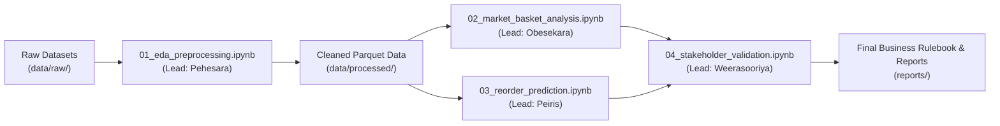

# Experimental Notebooks Guide

This directory contains the core analytical workflow notebooks for the Supermarket Retail Analytics project. Notebooks must be executed sequentially to maintain data dependency contracts.

---

## 1. Execution Order & Input/Output Contracts



### Notebook Specifications

| Notebook | Owner | Inputs | Outputs | Primary Techniques |
| :--- | :--- | :--- | :--- | :--- |
| **`01_eda_preprocessing.ipynb`** | **Pehesara W.A.C** (`IT24103684`) | `data/raw/` (Kaggle CSV, POS logs) | `data/processed/cleaned_transactions.parquet` | Schema validation, missing value imputation, type downcasting, stratified sampling, descriptive stats. |
| **`02_market_basket_analysis.ipynb`** | **Obesekara S.O.K.D** (`IT24103866`) | `data/processed/cleaned_transactions.parquet` | `reports/tables/top_association_rules.csv` | Basket transformation, FP-Growth baseline, Apriori/ECLAT benchmarks, Support/Confidence/Lift/Conviction pruning. |
| **`03_reorder_prediction.ipynb`** | **Peiris W.S.V** (`IT24103792`) | `data/processed/cleaned_transactions.parquet` | `models/reorder_classifier.joblib`, evaluation plots | Product-level feature engineering, Logistic Regression baseline, Decision Tree & Random Forest models, ROC-AUC. |
| **`04_stakeholder_validation.ipynb`** | **Weerasooriya W.H.M.S.P** (`IT24104192`) | Rules & models from 02 & 03, SL POS dataset | `reports/business_rules/store_layout_guide.md` | Sri Lankan FMCG cross-validation, stakeholder qualitative alignment, shelf layout & restocking action plan. |

---

## 2. Launching Notebooks & Picking the Correct Kernel

### Option A: Launching in Google Chrome
From the project root (`e:\Git_Projects\Supermarket`), run:
```powershell
.\launch_jupyter.ps1
```
Or with `.venv` active:
```powershell
jupyter lab
```

### Option B: Running Inside the IDE Editor
1. Click on any `.ipynb` file in this directory.
2. In the top-right corner of the editor, click **Select Kernel** $\rightarrow$ **Python Environments...**
3. Select **`Python (Supermarket ML)`** or **`.venv`**.

---

## 3. Kernel Verification Cell (Run First in Every Notebook)

Every notebook starts with this environment check. If this succeeds, your kernel is configured correctly:

```python
import sys
from pathlib import Path

# Add project root to sys.path so modules in src/ import cleanly
PROJECT_ROOT = Path("..").resolve()
if str(PROJECT_ROOT) not in sys.path:
    sys.path.append(str(PROJECT_ROOT))

# Verify core dependencies
import pandas as pd
import sklearn
import mlxtend

print(f"Kernel Python: {sys.executable}")
print("Environment OK: All project libraries imported cleanly.")
```

---

## 4. Saving Processed Data from the Browser to Local Files

When you execute cells in Google Chrome, the Python kernel runs on your local machine. You can save cleaned tables directly to `data/processed/`:

```python
from pathlib import Path

OUTPUT_DIR = Path("../data/processed")
OUTPUT_DIR.mkdir(parents=True, exist_ok=True)

# Save as optimized Parquet (recommended)
cleaned_df.to_parquet(OUTPUT_DIR / "cleaned_transactions.parquet", index=False)

# Or as CSV
cleaned_df.to_csv(OUTPUT_DIR / "cleaned_transactions.csv", index=False)

print(f"Data successfully saved locally to {OUTPUT_DIR}")
```
*The newly created files will appear immediately on your physical disk and in the IDE file tree.*

---

## 5. Cleanliness & Error-Prevention Rules

1. **Restart & Run All**: Before submitting or pushing code, select **Kernel ▸ Restart Kernel and Run All Cells** to verify that cells execute without error from top to bottom.
2. **Clear Heavy Outputs**: Do not save gigabytes of printed dataframes inside the `.ipynb` file. Limit outputs with `.head(10)`.
3. **No Heavy Logic in Cells**: Reusable data transformers and ML helpers belong in `src/`. Notebooks should import functions and focus on plots, metrics, and insights.
4. **Deterministic Models**: Always provide `random_state=42` when splitting datasets or initializing estimators.
